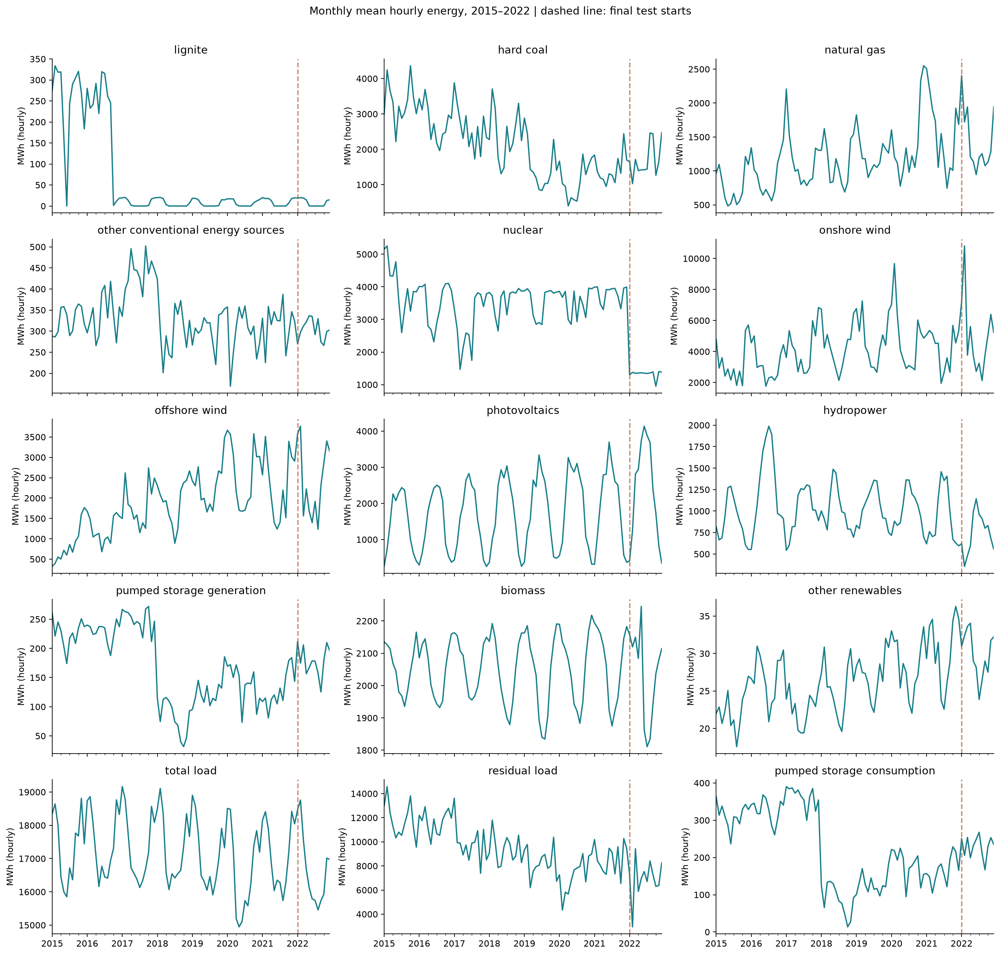
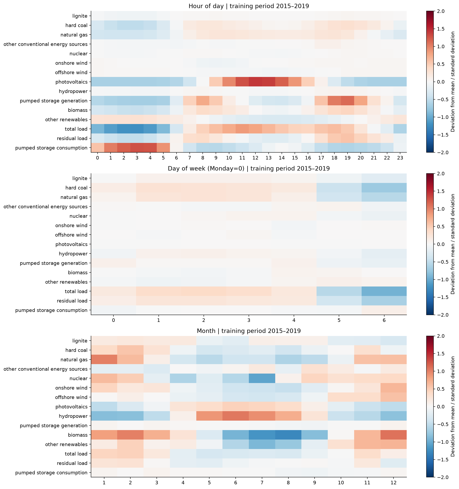
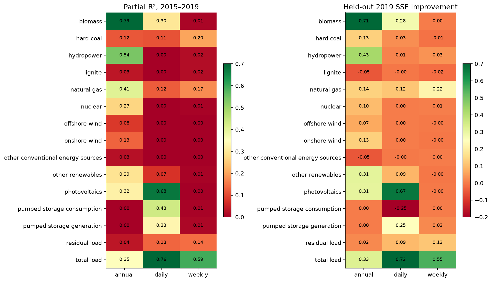
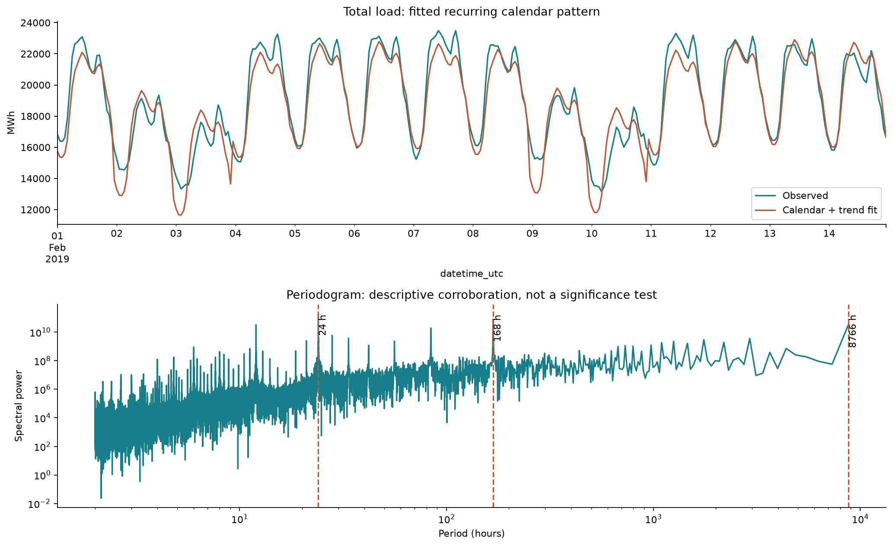
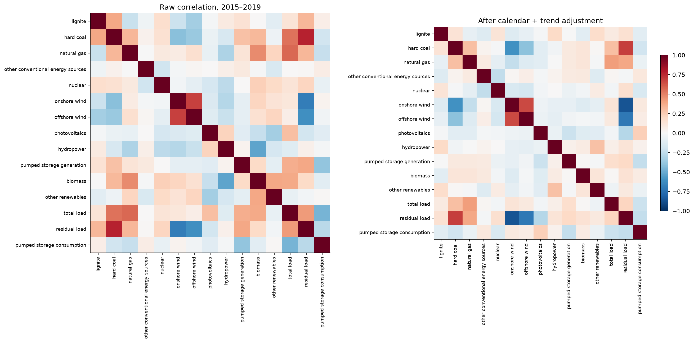
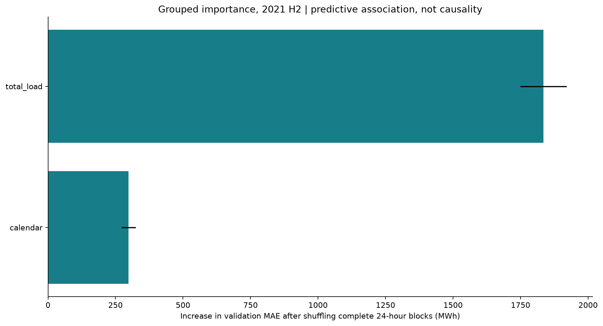
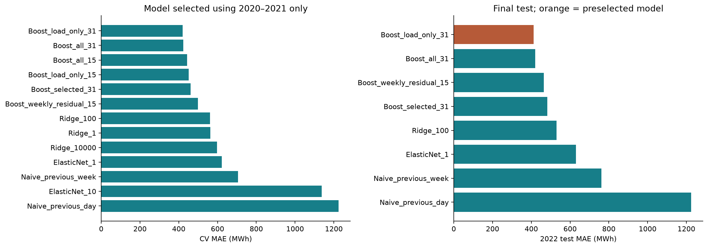
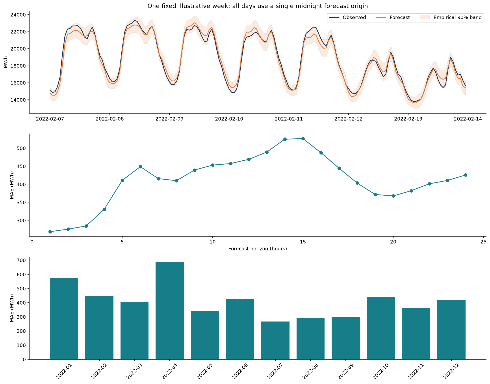

# TenneT 小时数据：从检查到 24 小时批量预测

这套 pipeline 已用提供的两个 CSV 实际运行。选择 **总负荷 Total load，原始字段 410_TenneT** 作为 response，在每个 UTC 零点一次输出未来 24 个小时。总负荷是用电需求指标，不是某一种能源的发电量；选择它是因为业务含义清楚、没有零值、季节规律可验证，也便于比较不同预测方法。

验证集选出的模型是 **Boost_load_only_31**。在独立的 2022 年测试窗口中，MAE 为 **412.4 MWh**，RMSE 为 **612.2 MWh**，WAPE 为 **2.47%**。相比复制上周同小时，MAE 下降 **45.8%**。本次结果支持保留负荷自身历史和已知日历特征；加入其他能源历史并未改善总体交叉验证 MAE。

## 1. 输入、字段映射与时间

输入文件是 `tennet_hourly_2015-01-01_2022-12-31.csv` 和 `tennet_series_mapping.csv`。原文件只读，未覆盖。ID 通过映射表的 `col_id` 匹配，保留德文名、英文名、单位及原始列名。建模名使用英文 snake_case，例如 `410_TenneT → Total load → total_load`。

- `column_dictionary.json` 提供 ID→英文名、原列名→建模名及反向 dictionary。
- `column_dictionary.csv` 是完整、可查看的字段字典。
- 清洗后的 `cleaned_hourly.parquet` 保留真正的带时区 datetime 类型；`cleaned_hourly.csv.gz` 便于互通，但 CSV 再次读取时仍须解析 datetime。

共有 **70,128 行、15 个数值序列和 2 个时间字段**。所有数值单位遵循映射文件的 **MWh**；月趋势图展示“该月平均每小时电量”，不是月累计发电量。

| 检查 | 结果 |
| --- | --- |
| UTC datetime 解析失败 | 0 |
| UTC 重复时间戳 | 0 |
| 原始 UTC 顺序 | 严格递增 |
| 相邻 UTC 间隔 | 70,127 个间隔全部为 1 小时 |
| 缺少的小时记录 | 0 |
| 数值 NaN / 无穷值 | 0 / 0 |
| UTC 与带偏移柏林时间指向同一时刻 | 全部一致 |
| 柏林本地重复墙钟小时 | 8 次，来自每年秋季夏令时切换 |
| 柏林本地 2 小时跳跃 | 8 次，来自每年春季夏令时切换 |

时间范围为 **2015-01-01 00:00 至 2022-12-31 23:00（Europe/Berlin）**；对应 UTC 是 2014-12-31 23:00:00+00:00 至 2022-12-31 22:00:00+00:00。不能删除本地重复小时，也不能把夏令时跳跃当作缺失值。

### 预测窗口的精确定义

令预测起点为 UTC 当日 00:00，模型预测当天 00:00–23:00 的 24 个小时区间。`horizon=1` 对应起点开始的第一个小时。24 个预测共用同一信息截止时刻，所有观测特征的时间都严格早于起点；不在预测过程中加入当天陆续观察到的真实值。采用一个 pooled direct 模型，结合 horizon 和日历信息，一次传入 24 行，不递归使用前一步预测。

柏林时间的对应窗口在冬季从 01:00 开始、夏季从 02:00 开始。它是固定 24 小时窗口；若业务要求柏林当地自然日，需要允许夏令时切换日输出 23 或 25 个值。代码假设上一小时读数在起点已发布，实际部署前需核实发布时间；若有发布延迟，必须增加滞后并重新回测。

## 2. EDA：季节性、趋势和异常



全期趋势图是回顾性描述。季节性与共线性诊断使用 2015–2019 年；模型选择只使用 2020–2021 年；2022 年不参与特征筛选和超参数选择。不同能源的水平与趋势变化明显，不能把长期容量变化、停机、调度变化都解释成季节性，也不能用全期均值替代近期状态。

本数据没有显式缺失，不代表没有测量问题。保留光伏夜间的零值、常规机组停机的零值和剩余负荷的负值。没有依据时，不按 IQR 或 z-score 批量删除真实峰值；这种处理会损害电力峰值预测。

### 怎样判断每个序列的季节性

先画柏林小时、星期和月份的平均剖面，再用“趋势 + 小时 dummy + 星期 dummy + 年度 Fourier 项（4 阶）”拟合。对日、周、年三组分别计算删除该组后的增量解释力：

`partial R² = 1 − SSE_full / SSE_without_that_group`。

为避免只在训练内看起来有效，另用 2015–2018 年拟合、2019 年验证，比较加入该组是否降低验证 SSE。表中“有支持”定义为训练 partial R² ≥ 0.02 且 2019 年 SSE 改善；“仅样本内”表示训练强度达到阈值但未跨年复现；“证据弱”表示未达训练阈值。这是探索性操作规则，不是显著性检验，也不是“没有季节性”的证明。括号内是 partial R²，各列不能相加。

| 变量 | 日周期 | 周周期 | 年周期 |
| --- | --- | --- | --- |
| 褐煤 / lignite | 证据弱 (0.003) | 仅样本内 (0.021) | 仅样本内 (0.033) |
| 硬煤 / hard_coal | 有支持 (0.111) | 仅样本内 (0.201) | 有支持 (0.116) |
| 天然气 / natural_gas | 有支持 (0.121) | 有支持 (0.175) | 有支持 (0.407) |
| 其他常规能源 / other_conventional_energy_sources | 证据弱 (0.002) | 证据弱 (0.002) | 仅样本内 (0.027) |
| 核电 / nuclear | 证据弱 (0.001) | 证据弱 (0.006) | 有支持 (0.266) |
| 陆上风电 / onshore_wind | 证据弱 (0.002) | 证据弱 (0.001) | 有支持 (0.131) |
| 海上风电 / offshore_wind | 证据弱 (0.001) | 证据弱 (0.001) | 有支持 (0.080) |
| 光伏 / photovoltaics | 有支持 (0.676) | 证据弱 (0.000) | 有支持 (0.319) |
| 水电 / hydropower | 证据弱 (0.003) | 证据弱 (0.019) | 有支持 (0.537) |
| 抽水蓄能发电 / pumped_storage_generation | 有支持 (0.330) | 证据弱 (0.011) | 证据弱 (0.003) |
| 生物质 / biomass | 有支持 (0.298) | 证据弱 (0.011) | 有支持 (0.794) |
| 其他可再生能源 / other_renewables | 有支持 (0.074) | 证据弱 (0.008) | 有支持 (0.291) |
| 总负荷 / total_load | 有支持 (0.756) | 有支持 (0.592) | 有支持 (0.347) |
| 剩余负荷 / residual_load | 有支持 (0.134) | 有支持 (0.141) | 有支持 (0.035) |
| 抽水蓄能用电 / pumped_storage_consumption | 仅样本内 (0.435) | 证据弱 (0.006) | 证据弱 (0.003) |

总负荷的日、周、年规律均有支持；光伏的日和年规律明显；陆上与海上风电表现出年度规律，但没有明显稳定的平均日、周周期。天然气、剩余负荷的日、周、年规律均有支持。抽水蓄能用电的日周期在训练期明显，但未通过该跨年验证，值得关注规律变化。核电等序列的年度项也可能吸收检修或结构变化，不能仅凭该表认定具有不变的物理周期。







`autocorrelation_diagnostics.csv` 还提供每个序列的 1、24、168、8760 小时自相关，比较原始值、日历调整后残差与 24 小时差分。8760 小时只作近似年度滞后，不精确对齐闰年与本地日历；相邻小时高度相关也不等于存在季节性。频谱是辅助证据，不单独作判断。

## 3. Multicollinearity：要对 predictor 集合判断

共线性是多个 predictors 之间的性质，不是某个序列自身的性质。pairwise correlation 只能发现两两相关，VIF 能检查一个 predictor 是否被其余 predictors 线性解释。

在训练期，存在精确关系：

`Total load = Residual load + Onshore wind + Offshore wind + Photovoltaics`。

全期间有 **99.903%** 的小时精确满足该式；剩余 **68** 条记录有差异，最大绝对差异 **337.0 MWh**。这些记录已单独导出为 `load_identity_discrepancies.csv`，未擅自修改。该关系足以说明，同小时剩余负荷等字段会让预测退化为目标的代数重建。

下面 VIF 采用 2015–2019 年数据。第一列把 response 也放入矩阵，仅用于展示全数据的线性关系；真正的 predictor 共线性应看后两列。

| 变量 | 全部15列（含目标） | 其余14个原始变量 | 去日历趋势后14变量 |
| --- | --- | --- | --- |
| lignite | 1.563 | 1.563 | 1.168 |
| hard_coal | 3.693 | 3.693 | 2.300 |
| natural_gas | 2.452 | 2.452 | 1.485 |
| other_conventional_energy_sources | 1.098 | 1.098 | 1.123 |
| nuclear | 1.302 | 1.302 | 1.181 |
| onshore_wind | ∞ | 4.316 | 7.561 |
| offshore_wind | ∞ | 2.866 | 3.116 |
| photovoltaics | ∞ | 2.033 | 2.446 |
| hydropower | 1.773 | 1.773 | 1.206 |
| pumped_storage_generation | 1.546 | 1.546 | 1.160 |
| biomass | 2.185 | 2.185 | 1.113 |
| other_renewables | 1.527 | 1.527 | 1.178 |
| total_load | ∞ | — | — |
| residual_load | ∞ | 12.722 | 17.355 |
| pumped_storage_consumption | 1.539 | 1.539 | 1.246 |

剩余负荷在候选 predictor 中 VIF 约 12.72，去日历趋势后约 17.36；这说明去季节性并不会自动消除共线性，有时还会显露原先被季节变化掩盖的依赖。



pipeline 的处理分为三层：

1. 排除剩余负荷这个派生变量，并对其他观测量只使用历史滞后或起点前统计量。同小时未来的真实风电、光伏、负荷均不可用。
2. 在每个训练折内剔除常数、绝对相关系数 ≥ 0.98 的冗余列，以及精确多变量线性依赖，例如 `weekend = Saturday + Sunday`。变换器不在验证集或测试集上拟合。
3. 比较 Ridge 的 L2 稳定化、ElasticNet 的收缩/稀疏化、ElasticNet 特征筛选后的梯度提升，以及只用负荷历史的梯度提升。树模型对共线性的主要代价通常是冗余和解释不稳定，不必为了达到某个 VIF 阈值丢掉有用滞后。

最终模型实际设计矩阵从 **47** 个非恒定候选特征降为 **46** 个特征，矩阵秩为 **46**。精确依赖已清除，但仍有 **7** 个特征 VIF > 10，最大有限 VIF 为 **48.9**。这是滞后、滚动统计与日历编码之间的近似共线性，不能声称全部消失；最终模型使用树回归，不对这些列的单独回归系数作因果解释。完整结果见 `model_feature_vif.csv`。

## 4. 季节性应如何处理

**季节性是可预测信息，不一定是需要清除的噪声。** 本次比较了保留日历与季节滞后的模型，以及显式周差分模型：

`z[t] = y[t] − y[t−168]`，预测后 `y_hat[t] = z_hat[t] + y[t−168]`。

对于固定 24 小时预测窗口，`y[t−168]` 始终已知，因此这个还原过程不需要未来值。该差分候选的验证 MAE 为 **498.2 MWh**，最终入选模型为 **419.6 MWh**，所以没有强制采用差分模型。固定 168 小时也会在夏令时切换附近与柏林同一墙钟小时错位，日历特征可以提供补充信息。

`calendar_adjusted_training.parquet` 保存趋势和日历成分调整后的训练期残差，可用于检查季节性影响；它是诊断文件，不直接当作无泄漏的全期预测输入。没有先对全数据做双向平滑或 STL 分解再切分训练/测试。若采用需要平稳性的 ARIMA，应另行检查差分阶数并仅在训练窗口拟合；当前树回归不要求原序列平稳。

## 5. Missing values：当前结果与未来方案

当前所有字段均无 NaN，也无缺少的小时，所以**本次没有人为插补真实原始观测**。pipeline 仍能把未来出现的缺失小时 reindex 到 UTC 小时网格，并在特征生成前作因果处理：最多向前填 2 小时，然后依次尝试前 1–4 周同小时和前一天同小时；仍缺失的 predictor 用该训练折拟合的中位数兜底。标准化、筛选与填补器都随训练折重新拟合。

| 情况 | 处理建议 |
| --- | --- |
| response 缺失 | 不将插补值作为监督标签，也不在它上面计算测试误差；目标历史可按 predictor 规则处理 |
| 慢变变量短缺口 | 可尝试有限长度 forward fill，保留缺失标记与数据龄期 |
| 负荷、光伏等强季节变量 | 优先比较同星期/同小时历史、多周历史及条件季节模型；不能统一填全期均值 |
| 风电等受天气影响大的变量 | 周期填补可能很差；优先使用可得天气/邻区信息，或训练窗口内的多变量模型 |
| 连续长缺口 | 明确标记、降低可信度；不要长时间延续一个读数；必要时停止该模型并切换基线 |
| 离线历史修复 | 小缺口可评估双向插值，但这与实时预测的可用信息不同，不可跨验证边界使用 |

代码的季节回填是可执行的通用兜底，不是已证明适合每个能源序列的最优插补器。当前数据无缺失，因此没有从真实缺失事件估计最优政策。生产版建议增加显式缺失标记和数据龄期，并对各类能源分别校准。

为提供实际依据，在 2017–2019 年负荷历史中人工遮盖 1、3、24、168 小时块（每种长度随机放置 30 个起点，可能重叠），只用过去信息评估。MAE 仅在能填补的遮盖点上计算，必须同时看 coverage；不同 coverage 的 MAE 不宜直接排名。此实验不能代表自然缺失机制，也不能直接推广到所有能源。

| gap_hours | method | masked_hours | coverage | MAE |
| --- | --- | --- | --- | --- |
| 1 | forward_fill | 30 | 1.000 | 708.708 |
| 1 | previous_day | 30 | 1.000 | 1,493.117 |
| 1 | previous_week | 30 | 1.000 | 872.983 |
| 1 | bounded_forward_then_seasonal | 30 | 1.000 | 708.708 |
| 3 | forward_fill | 90 | 1.000 | 1,377.519 |
| 3 | previous_day | 90 | 1.000 | 1,209.858 |
| 3 | previous_week | 90 | 0.967 | 889.310 |
| 3 | bounded_forward_then_seasonal | 90 | 1.000 | 1,052.244 |
| 24 | forward_fill | 702 | 1.000 | 2,865.705 |
| 24 | previous_day | 702 | 0.957 | 1,428.686 |
| 24 | previous_week | 702 | 0.981 | 1,006.772 |
| 24 | bounded_forward_then_seasonal | 702 | 1.000 | 968.828 |
| 168 | forward_fill | 4331 | 1.000 | 3,484.889 |
| 168 | previous_day | 4331 | 0.122 | 1,143.399 |
| 168 | previous_week | 4331 | 0.788 | 745.718 |
| 168 | bounded_forward_then_seasonal | 4331 | 1.000 | 681.462 |

## 6. Predictor 构造与筛选

最初候选包含：负荷在预测目标时刻的 24、48、168、336 小时滞后；起点前最后一个负荷值；起点前 24、168 小时的均值和标准差；其他能源的 24、168 小时滞后和起点前 24 小时均值；柏林小时、星期、年度 Fourier 项、趋势和预测 horizon。

这些特征都能在单一预测起点计算。`lag24` 虽然相对于每个目标小时变化，但窗口最后一小时的 lag24 仍是起点前一小时。没有使用当日真实发电量，也没有使用任何外部天气数据或不确定的事后信息。

筛选流程是：业务可用性过滤 → 每折训练内相关/秩过滤 → 正则化及特征子集候选 → 2020–2021 时间验证比较。`Boost_selected_31` 在训练内标准化后，用 ElasticNet 绝对系数阈值（中位数）选择列，再训练梯度提升。另把 all 与 load-only 在相同 15/31 叶节点设置下对比，避免把模型复杂度变化误认为额外 predictors 的作用。

相同 31 叶节点配置下，加入其他能源历史使验证 MAE 相比只用负荷历史**增加 4.07 MWh**。因此最终选择 `Boost_load_only_31`；其他能源序列在本轮实验中没有被保留。差异较小时应理解为本次验证选择，不是“其他能源永远无用”的结论。数据中多个高相关负荷滞后也保留了预测信息。

最终保留的 46 个特征逐项记录在 `selected_features.csv`。验证集 grouped permutation importance 按完整 24 小时块打乱特征组，主要用于检查负荷历史和日历的预测作用；相关性仍可能稀释重要性，不能解释成因果贡献，也不据此在最终测试集上反复选择变量。



## 7. 按时间验证与模型比较

| 折 | 训练目标区间 | 验证区间 |
| --- | --- | --- |
| 1 | 2015–2019 可用完整日 | 2020 全年 |
| 2 | 2015–2020 可用完整日 | 2021 上半年 |
| 3 | 2015–2021 上半年可用完整日 | 2021 下半年 |
| 最终测试 | 2015–2021 可用完整日重新训练 | 2022 年可用完整 UTC 日 |

前 28 天作为最长滞后/填补历史的预热。每折按 UTC 日边界划分，所有训练标签均早于下一验证起点；因此本构造不需要额外人为 gap。若换成一天内滚动发布或标签窗口跨边界，则必须重新核查 purge/gap。验证期内每天可以使用此前已经观察到的真实历史，但模型参数在整个验证折内固定；最终测试也只更新可用历史，不用 2022 标签再训练评估模型。

比较 13 个候选配置：2 个季节基线、3 个 Ridge alpha、2 个 ElasticNet alpha、all/load-only 各 2 种树复杂度、1 个 ElasticNet 筛选后树模型、1 个显式周差分树模型。HGB 使用 220 次迭代、学习率 0.06、最小叶样本数 40、L2 正则 10；关闭随机内部验证式 early stopping。按三个验证窗口**小时数加权的 MAE**选模型，2020 全年权重相应大于单个半年折。

| model | weighted_CV_MAE | weighted_CV_RMSE |
| --- | --- | --- |
| Boost_load_only_31 | 419.556 | 588.929 |
| Boost_all_31 | 423.622 | 600.652 |
| Boost_all_15 | 443.053 | 629.197 |
| Boost_load_only_15 | 450.649 | 632.239 |
| Boost_selected_31 | 461.150 | 677.165 |
| Boost_weekly_residual_15 | 498.224 | 695.132 |
| Ridge_100 | 560.794 | 767.828 |
| Ridge_1 | 563.622 | 769.667 |
| Ridge_10000 | 597.018 | 843.038 |
| ElasticNet_1 | 621.568 | 872.882 |
| Naive_previous_week | 705.526 | 1,112.271 |
| ElasticNet_10 | 1,138.076 | 1,378.678 |
| Naive_previous_day | 1,224.548 | 1,862.588 |

模型选择在测试评分前锁定。以下展示每类经验证选出的代表模型在同一最终测试窗口的表现；没有按照测试成绩更换预先选出的模型。

| model | selected_before_test | MAE | RMSE | WAPE_pct | R2 | MASE_weekly |
| --- | --- | --- | --- | --- | --- | --- |
| Boost_load_only_31 | True | 412.448 | 612.217 | 2.473 | 0.956 | 0.540 |
| Boost_all_31 | False | 420.709 | 622.749 | 2.522 | 0.954 | 0.551 |
| Boost_weekly_residual_15 | False | 464.251 | 668.426 | 2.783 | 0.947 | 0.608 |
| Boost_selected_31 | False | 482.638 | 703.134 | 2.894 | 0.941 | 0.632 |
| Ridge_100 | False | 530.680 | 750.654 | 3.182 | 0.933 | 0.695 |
| ElasticNet_1 | False | 631.086 | 882.293 | 3.784 | 0.908 | 0.827 |
| Naive_previous_week | False | 761.262 | 1,202.557 | 4.564 | 0.828 | 0.997 |
| Naive_previous_day | False | 1,224.809 | 1,839.482 | 7.343 | 0.599 | 1.605 |

测试覆盖 **364 个完整 UTC 日、8,736 小时**，从 2022-01-01 00:00:00+00:00 到 2022-12-30 23:00:00+00:00。2022-12-31 在文件中仅有 23 个 UTC 小时，所以不把它作为完整 24 小时测试日。原始柏林时间序列没有缺失；这是 UTC 日边界与数据截断的差异。

MAE/RMSE 单位均为 MWh。WAPE 是 `sum(abs(error)) / sum(abs(actual))`，不是逐点 MAPE；R² 相对于测试期均值；MASE 的尺度使用训练期 168 小时差分 MAE，低于 1 表示优于该训练尺度，不能替代同一测试集上与基线的直接比较。

相对上周基线，日 MAE 的平均改善为 **348.8 MWh**。按连续 7 天块做 2,000 次 bootstrap 的条件性 95% 区间为 **[228.8, 459.5] MWh**；它不覆盖未来制度变化或重新训练的不确定性。



## 8. 预测误差、区间与限制



用 2021 年验证误差，对每个 horizon 计算绝对误差的 90% 分位数，给点预测加减该半径，负下界截为 0。最终测试实际覆盖率为 **88.78%**，平均带宽 **1628.8 MWh**。它是经验预测带，不是保证 90% 覆盖的置信区间；校准模型与最终重训模型不同，时间依赖和漂移也会影响覆盖。

测试残差在 1、24、168 小时的自相关分别为 **0.913、0.151、-0.085**。模型还有未解释的时间结构，不能声称季节性或误差相关已全部去除。完整分时距、分月份结果见 `test_metrics_by_horizon.csv`、`test_metrics_by_month.csv`。

本轮只用现有数据与可计算日历，没有温度预报、公共假日日历或来源发布时刻；这些都是后续可检验的信息，而不是本次已验证的改进。已跑完的比较范围是上述 13 个配置，不能据此声称在所有 ARIMA、神经网络或其他模型中全局最优。

## 9. 重现与再次预测

建议 Python 3.12。依赖精确版本记录在 `requirements.txt`，源文件 SHA-256、随机种子、切分规则在 `results/run_manifest.json`。在解压目录执行：

```bash
python -m venv .venv
source .venv/bin/activate
python -m pip install -r requirements.txt
python tennet_pipeline.py --data /path/to/tennet_hourly_2015-01-01_2022-12-31.csv --mapping /path/to/tennet_series_mapping.csv --out results
```

`tennet_analysis.ipynb` 是中文逐步说明与可执行检查入口，内含已执行的摘要输出。默认读取已生成结果；将 `RUN_FULL_PIPELINE=True` 会重新运行分析、验证和训练。

`evaluation_model.joblib` 仅用 2022 年之前数据拟合，用于保持最终测试独立。`production_model.joblib` 在测试评分后用全部可用完整日重训，最后训练目标为 2022-12-30 23:00 UTC；它不能回头用于宣称 2022 年测试成绩。

```bash
python predict_24h.py --model results/production_model.joblib --data /path/to/tennet_hourly_2015-01-01_2022-12-31.csv --mapping /path/to/tennet_series_mapping.csv --origin 2022-12-31T00:00:00Z --out forecast_24h.csv
```

这个命令输出历史末端的 24 小时示例，其中源数据有前 23 小时的真实值，最后一小时无真实值用于核验。它不是 2026 年预测。若要预测 2023-01-01 的完整 UTC 日，需要先补充上一小时 2022-12-31 23:00 UTC 的真实历史；代码会拒绝缺少末端历史时伪造该读数。预测助手也会拒绝使用训练时间晚于预测起点的模型。

已经执行的检查包括：未来数据全部改写不改变起点特征、截断到起点前历史仍生成相同特征、每个起点恰有 24 个输出、目标时间不重复、标签与原始数据逐点对齐、保存后重新加载模型可复现预测。部署时还应监测按 horizon 的误差、区间覆盖和数据缺失，建立发布延迟规则，再选择重训频率。

## 10. 交付文件

| 文件 | 用途 |
| --- | --- |
| `tennet_pipeline.py` | 全流程源码，可重跑并复用主要函数 |
| `predict_24h.py` | 加载已训练模型，一次生成 24 小时预测 |
| `tennet_analysis.ipynb` | 中文说明、已执行摘要、可运行的检查与预测 |
| `results/column_dictionary.json` / `.csv` | ID、名称、单位字典 |
| `results/cleaned_hourly.parquet` / `.csv.gz` | 重命名后的完整小时数据 |
| `results/seasonality_by_variable.csv` | 每列、每种周期的量化证据 |
| `results/vif_diagnostics.csv`、`model_feature_vif.csv` | 原变量与实际模型特征的共线性 |
| `results/selected_features.csv` | 最终实际保留的特征 |
| `results/cv_scores.csv`、`cv_ranking.csv`、`test_scores.csv` | 所有配置验证分数和独立测试分数 |
| `results/test_predictions_24h.csv` | 每个测试起点的 24 小时预测、真实值与经验预测带 |
| `results/endpoint_24h_forecast_demo.csv` | 数据末端的 24 小时演示 |
| `results/evaluation_model.joblib`、`production_model.joblib` | 两种用途的已训练模型 |
| `results/figures/` | 8 张可独立使用的 PNG 图 |

## 方法参考

时间验证与基线比较参考 [Forecasting: Principles and Practice — The forecaster’s toolbox](https://otexts.com/fpp3/toolbox.html)。训练内预处理与防泄漏原则参考 [scikit-learn — Common pitfalls](https://scikit-learn.org/stable/common_pitfalls.html)。相关变量会影响置换重要性的解释，参考 [scikit-learn — Permutation importance with multicollinear features](https://scikit-learn.org/stable/auto_examples/inspection/plot_permutation_importance_multicollinear.html)。所有数值结论均由提供的 CSV 实际计算，探索性阈值与预测窗口是本 pipeline 明确采用的分析设定。
